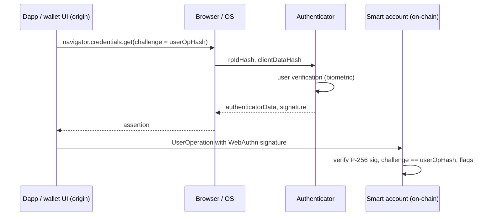

# WebAuthn Fundamentals and the Passkey Wallet Threat Model

Passkeys let users sign in with a fingerprint or face scan instead of a password. Under the hood they are WebAuthn credentials: asymmetric key pairs held by an authenticator and bound to a website. Web3 wallets now use the same credentials to sign blockchain transactions, usually through smart accounts that verify P-256 signatures. This chapter explains the WebAuthn data model and frames the threats specific to wallets.

## Actors and objects

| Term | Meaning |
|---|---|
| Relying Party (RP) | the website or app that registers and verifies credentials; identified by an RP ID (a domain) |
| Authenticator | holds private keys: platform (phone, laptop secure hardware) or roaming (security key) |
| Client | the browser or OS that mediates between RP and authenticator |
| Credential | key pair plus credential ID, scoped to one RP ID |
| Passkey | a discoverable (resident) credential, often synced across a user's devices |
| User presence (UP) / user verification (UV) | tap vs biometric/PIN check, reported as flags |

## What gets signed

During authentication the RP sends a random **challenge**. The client builds `clientDataJSON`, which contains the type (`webauthn.get`), the challenge (base64url), and the **origin** the browser actually saw. The authenticator builds `authenticatorData`, which contains:

- `rpIdHash`: SHA-256 of the RP ID;
- flags: UP, UV, backup eligibility (BE), backup state (BS), attested data, extensions;
- `signCount`.

The authenticator then signs:

```text
signature = Sign(privateKey, authenticatorData || SHA-256(clientDataJSON))
```

For passkeys the algorithm is usually ES256: ECDSA over the NIST P-256 curve (secp256r1) with SHA-256. Ethereum and Bitcoin natively use secp256k1, which is why passkey wallets need P-256 verification on-chain (chapter 3).

## From login to wallet

A passkey wallet replaces the RP's random challenge with something meaningful, typically a hash of the transaction or ERC-4337 UserOperation. The smart account checks that:

1. the signature is valid for the account's registered P-256 public key;
2. the challenge inside `clientDataJSON` equals the operation hash;
3. required flags (UP, often UV) are set;
4. optionally, the type and origin fields match expectations.



## Threat model

Strengths compared with seed-phrase wallets:

- **No seed phrase to phish.** The private key never leaves the authenticator (or the sync fabric).
- **Origin binding.** The browser only lets a page use credentials for its own RP ID, so a phishing domain cannot get a signature from the real wallet's passkey.

New or shifted risks:

- **What-you-see is not shown.** The OS passkey prompt shows the site name, not the transaction. The user trusts the wallet's web page to show what is being signed. A compromised wallet front-end can ask the passkey to sign anything; see **web3-supply-chain-security**.
- **Platform account = wallet.** Synced passkeys are as secure as the Apple, Google or password-manager account that syncs them, including its recovery process (chapter 2).
- **Verifier bugs.** Smart-account WebAuthn parsing and P-256 verification are new code paths with subtle edge cases.
- **Device loss.** Device-bound credentials vanish with the device; accounts need backup signers.
- **Domain risk.** Losing control of the RP domain (expiry, DNS hijack) affects who can request signatures.

## Compared with other wallet types

A seed-phrase software wallet keeps the key in application memory on a general-purpose device, so malware and phishing for the phrase are the main threats. A hardware wallet keeps the key on a dedicated device with its own screen, so the user can check what is signed even if the computer is compromised. A passkey wallet sits between them: the key is in secure hardware (or a sync fabric) and cannot be phished as text, but there is no independent screen showing the transaction. The honest summary is that passkeys remove the seed-phrase problem and move the remaining trust onto the wallet front-end and the platform account. Later chapters treat each of those in turn.

## Worked example

> **Execution status:** not executed in this book's CI. Commands, code and expected results below are written from documentation, not observed output; verify locally.

Register and use a credential with Chrome's virtual authenticator, on localhost, to see the raw objects.

1. Serve a page on `http://localhost:8000` (localhost is treated as a secure context) with:

```html
<script>
async function reg() {
  const cred = await navigator.credentials.create({ publicKey: {
    challenge: crypto.getRandomValues(new Uint8Array(32)),
    rp: { name: "Lab", id: "localhost" },
    user: { id: new Uint8Array([1]), name: "alice", displayName: "Alice" },
    pubKeyCredParams: [{ type: "public-key", alg: -7 }],
    authenticatorSelection: { residentKey: "required", userVerification: "required" }
  }});
  window.cred = cred; console.log(cred);
}
async function sign(hex) {
  const challenge = Uint8Array.from(hex.match(/../g).map(b => parseInt(b, 16)));
  const a = await navigator.credentials.get({ publicKey: { challenge, rpId: "localhost", userVerification: "required" }});
  console.log(new TextDecoder().decode(a.response.clientDataJSON));
  console.log(new Uint8Array(a.response.authenticatorData));
}
</script>
<button onclick="reg()">register</button>
```

2. In Chrome DevTools, open the WebAuthn panel, enable the virtual authenticator environment, and add a CTAP2 internal authenticator with resident keys and user verification.
3. Call `reg()`, then `sign("aa".repeat(32))` from the console. Inspect `clientDataJSON`: note `type`, base64url `challenge` and `origin`.
4. Decode the first 37 bytes of `authenticatorData`: 32-byte `rpIdHash`, 1 flags byte, 4-byte `signCount`. Compute `sha256("localhost")` and compare with `rpIdHash`.

## Common pitfalls

- Assuming the passkey prompt shows transaction details.
- Treating "no seed phrase" as "no recovery risk".
- Comparing challenges as raw bytes when `clientDataJSON` carries base64url text.
- Forgetting that `alg: -7` means P-256, not secp256k1.
- Testing on non-localhost HTTP origins, which browsers reject for WebAuthn.

## Exercises

1. Decode every flag bit in an assertion's `authenticatorData` and record which are set for your virtual and real authenticators.
2. Verify an assertion's signature off-chain in Python using the `cryptography` library and the public key from registration.
3. List every party whose compromise would let an attacker produce a valid signature for a passkey wallet you know.

## Further reading

- W3C Web Authentication Level 3: <https://www.w3.org/TR/webauthn-3/>
- FIDO Alliance specifications (CTAP 2.x): <https://fidoalliance.org/specifications/>
- passkeys.dev developer resources: <https://passkeys.dev>
- Chrome DevTools WebAuthn panel documentation
- See **account-abstraction-security** and **web3-supply-chain-security**
