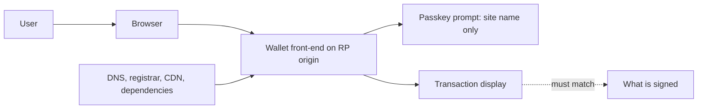

# Passkey Wallet Review Checklist

This chapter consolidates the book into a review checklist for passkey-based wallets, covering registration and attestation, the on-chain verifier, the front-end trust base, and recovery. Test with your own credentials on local chains or testnets, and report vulnerabilities privately to the wallet team.

## Registration and attestation

Attestation lets an authenticator prove what kind of device it is, via an attestation statement (formats such as `packed`, `tpm`, `android-key`, `apple`, or `none`) and an AAGUID identifying the model. The FIDO Metadata Service (MDS) publishes metadata and certification status for many authenticators.

| Check | Notes |
|---|---|
| Is attestation requested and verified? | most consumer passkeys use `none`; that is fine if the policy does not depend on device type |
| If policy depends on device type (e.g. "hardware key above limit"), is attestation verified against MDS? | otherwise the AAGUID is just a claim |
| Are BE/BS flags recorded? | needed for synced vs device-bound policies (chapter 2) |
| Is the public key extracted correctly from COSE? | x and y 32 bytes each, leading zeros kept |
| Is the registration bound to the user's account creation flow and not replayable? | registration challenge single-use |

## On-chain verifier

- Precompile call checks both success and a 32-byte return equal to 1; empty return is failure.
- Fallback Solidity verifier is audited and pinned.
- Signature malleability handled; no use of signature bytes as identifiers.
- `type == "webauthn.get"` checked.
- Challenge located at the `challenge` key and compared to base64url(userOpHash).
- UP required; UV required if policy says so.
- `rpIdHash` / origin checks present or deliberately omitted, with documented reasoning.
- Gas limits sufficient on chains without the precompile.
- Behaviour on every target chain tested, including chains lacking RIP-7212.

## Account logic

- Owner management requires the right signer and, ideally, a delay.
- Multiple owners supported; at least one non-passkey or differently-hosted signer recommended.
- Cross-chain replay of owner-change signatures is intentional and scoped.
- Validation obeys ERC-7562 rules.

## Front-end and domain

- Front-end built reproducibly, with SRI and strict CSP.
- Third-party scripts minimised and pinned.
- Domain protected with registrar locks and monitored.
- Related origins listed only when necessary.
- Native app associations verified.
- Transaction decoding shown to the user from data the front-end cannot silently change (for example, simulation from an independent service, and clear display of target, value and calldata).

## Recovery and lifecycle

- Users prompted to add a second signer before holding significant value.
- Device loss and platform-account loss paths documented and tested.
- Guardian or backup-signer changes delayed and notified.
- Domain-loss scenario addressed.

## AI-assisted review

LLMs can help read verifier code and suggest test cases. Treat every suggestion as a hypothesis: write the Foundry test, run it, and include only findings that a test demonstrates. The model proposes; the test decides.

## Severity guide

| Severity | Example |
|---|---|
| Critical | verifier accepts invalid signatures (empty precompile return treated as success, challenge not bound) |
| High | front-end supply chain can change transactions without any independent check; passkey-only accounts for large balances with no recovery |
| Medium | missing UV where policy requires it; insufficient gas on some chains |
| Low | missing events, documentation gaps |

## Worked example

> **Execution status:** not executed in this book's CI. Commands, code and expected results below are written from documentation, not observed output; verify locally.

Review the Foundry validator from chapters 3–5 and produce test-backed findings.

1. Run the full test suite with `forge test -vv` and keep the output.
2. Add a test that deploys the validator configured to use the precompile only, on a chain without it (the default local EVM may lack it). If `verify` returns true for a garbage signature, that is a Critical finding; the chapter 3 `verifyPrecompile` pattern should make it return false.
3. Add a test that reuses a valid signature with `s` replaced by `n - s`. If accepted, check whether anything in the account uses signature bytes as a key. Record the result.
4. Add a test where flags lack UV. Decide whether it should pass according to your policy and assert accordingly.
5. Write each finding with title, severity, the test name proving it, and the fix; rerun tests after each fix.

## Common pitfalls

- Reviewing the verifier but not the front-end that decides what gets signed.
- Accepting attestation claims without verifying them against metadata.
- Testing only on chains with the precompile.
- Treating platform account recovery as out of scope.
- Reporting findings without a reproducing test.

## Exercises

1. Run this checklist on an open-source passkey wallet and list the top five findings or open questions.
2. Verify a `packed` attestation from a hardware security key in Python using a WebAuthn server library (for example `py_webauthn`) and look up its AAGUID in FIDO MDS.
3. Write a CI job that runs your verifier test suite against two forks: one with RIP-7212 and one without.

## Further reading

- FIDO Metadata Service: <https://fidoalliance.org/metadata/>
- py_webauthn: <https://github.com/duo-labs/py_webauthn>
- W3C WebAuthn Level 3, attestation: <https://www.w3.org/TR/webauthn-3/>
- RIP-7212 and EIP-7951
- See **account-abstraction-security**, **social-recovery-security** and **web3-supply-chain-security**
